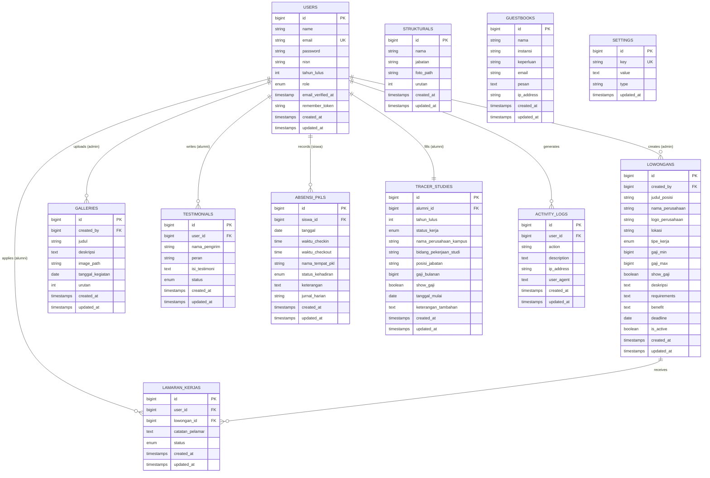

# 🗃️ Entity Relationship Diagram (ERD)
## Bursa Kerja Khusus (BKK) Vokasi Karir

> **Database:** MySQL 8.0+
> **ORM:** Laravel Eloquent
> **Stack:** Laravel 13 + Inertia.js + React 19
> **Role System:** `superadmin` · `admin` · `siswa` · `alumni`

---

## ERD Visual (Mermaid)



---

## Deskripsi Tabel

---

### 1. `users`

Tabel master untuk semua pengguna sistem (admin, siswa, alumni).

| Kolom | Tipe | Constraint | Deskripsi |
|-------|------|-----------|----------|
| `id` | BIGINT UNSIGNED | PK, AUTO_INCREMENT | Primary key |
| `name` | VARCHAR(255) | NOT NULL | Nama lengkap user |
| `email` | VARCHAR(255) | NOT NULL, UNIQUE | Email (untuk login) |
| `password` | VARCHAR(255) | NOT NULL | Password (bcrypt hash) |
| `nisn` | VARCHAR(20) | NULLABLE | NISN siswa / NIS alumni (opsional) |
| `tahun_lulus` | YEAR | NULLABLE | Tahun lulus (untuk alumni, filter tracer study) |
| `role` | ENUM | NOT NULL, DEFAULT `siswa` | Role user |
| `email_verified_at` | TIMESTAMP | NULLABLE | Waktu verifikasi email |
| `remember_token` | VARCHAR(100) | NULLABLE | Token "ingat saya" |
| `created_at` | TIMESTAMP | NULLABLE | Waktu dibuat |
| `updated_at` | TIMESTAMP | NULLABLE | Waktu diperbarui |

**Enum `role`:**
| Value | Deskripsi | Akses |
|-------|-----------|-------|
| `superadmin` | IT Administrator | Memantau log aktivitas, mengubah role user, seluruh admin panel + publik |
| `admin` | Staff/guru BKK | Semua admin panel (konten, user, pkl, tracer) + publik |
| `siswa` | Siswa aktif SMK | Dashboard PKL + absensi + publik |
| `alumni` | Lulusan SMK | Dashboard alumni + tracer study + lamar loker + publik |

**Indexes:**
```sql
UNIQUE INDEX idx_users_email (email)
INDEX idx_users_role (role)
INDEX idx_users_tahun_lulus (tahun_lulus)
```

---

### 2. `lowongans`

Tabel master lowongan kerja yang diposting oleh admin.

| Kolom | Tipe | Constraint | Deskripsi |
|-------|------|-----------|-----------|
| `id` | BIGINT UNSIGNED | PK, AUTO_INCREMENT | Primary key |
| `created_by` | BIGINT UNSIGNED | FK → users.id, ON DELETE SET NULL | Admin yang membuat |
| `judul_posisi` | VARCHAR(255) | NOT NULL | Judul posisi pekerjaan |
| `nama_perusahaan` | VARCHAR(255) | NOT NULL | Nama perusahaan |
| `logo_perusahaan` | VARCHAR(255) | NULLABLE | Path logo perusahaan |
| `lokasi` | VARCHAR(255) | NOT NULL | Kota/daerah lokasi kerja |
| `tipe_kerja` | ENUM | NOT NULL | Tipe pekerjaan |
| `gaji_min` | BIGINT UNSIGNED | NULLABLE | Gaji minimum (Rupiah) |
| `gaji_max` | BIGINT UNSIGNED | NULLABLE | Gaji maksimum (Rupiah) |
| `show_gaji` | BOOLEAN | NOT NULL, DEFAULT false | Tampilkan info gaji? |
| `deskripsi` | TEXT | NOT NULL | Deskripsi pekerjaan |
| `requirements` | TEXT | NOT NULL | Persyaratan pelamar |
| `benefit` | TEXT | NULLABLE | Keuntungan / fasilitas |
| `deadline` | DATE | NOT NULL | Batas akhir pendaftaran |
| `is_active` | BOOLEAN | NOT NULL, DEFAULT true | Status aktif lowongan |
| `created_at` | TIMESTAMP | NULLABLE | |
| `updated_at` | TIMESTAMP | NULLABLE | |

**Enum `tipe_kerja`:**
- `full_time`
- `part_time`
- `magang`
- `kontrak`
- `freelance`

**Indexes:**
```sql
INDEX idx_lowongans_is_active (is_active)
INDEX idx_lowongans_deadline (deadline)
INDEX idx_lowongans_tipe_kerja (tipe_kerja)
INDEX idx_lowongans_lokasi (lokasi)
FULLTEXT idx_lowongans_search (judul_posisi, nama_perusahaan, lokasi)
```

---

### 3. `lamaran_kerjas`

Tabel perantara antara user (pelamar) dan lowongan. Menyimpan data lamaran pekerjaan.

| Kolom | Tipe | Constraint | Deskripsi |
|-------|------|-----------|-----------|
| `id` | BIGINT UNSIGNED | PK, AUTO_INCREMENT | Primary key |
| `user_id` | BIGINT UNSIGNED | FK → users.id, ON DELETE CASCADE | User yang melamar |
| `lowongan_id` | BIGINT UNSIGNED | FK → lowongans.id, ON DELETE CASCADE | Lowongan yang dilamar |
| `catatan_pelamar` | TEXT | NULLABLE | Catatan/cover letter singkat |
| `status` | ENUM | NOT NULL, DEFAULT `pending` | Status lamaran |
| `created_at` | TIMESTAMP | NULLABLE | Waktu melamar |
| `updated_at` | TIMESTAMP | NULLABLE | |

**Enum `status`:**
- `pending` — Belum diproses
- `diterima` — Diterima untuk proses selanjutnya
- `ditolak` — Ditolak
- `dipanggil` — Dipanggil tes/wawancara

**Constraints:**
```sql
UNIQUE INDEX idx_lamaran_user_lowongan (user_id, lowongan_id) -- 1 user hanya bisa lamar 1x per lowongan
INDEX idx_lamaran_status (status)
```

---

### 4. `galleries`

Tabel untuk menyimpan foto-foto kegiatan BKK.

| Kolom | Tipe | Constraint | Deskripsi |
|-------|------|-----------|-----------|
| `id` | BIGINT UNSIGNED | PK, AUTO_INCREMENT | Primary key |
| `created_by` | BIGINT UNSIGNED | FK → users.id, ON DELETE SET NULL | Admin yang upload |
| `judul` | VARCHAR(255) | NOT NULL | Judul foto/kegiatan |
| `deskripsi` | TEXT | NULLABLE | Deskripsi kegiatan |
| `image_path` | VARCHAR(255) | NOT NULL | Path file gambar di storage |
| `tanggal_kegiatan` | DATE | NULLABLE | Tanggal kegiatan berlangsung |
| `urutan` | INT | NOT NULL, DEFAULT 0 | Urutan tampil (sortable) |
| `created_at` | TIMESTAMP | NULLABLE | |
| `updated_at` | TIMESTAMP | NULLABLE | |

**Indexes:**
```sql
INDEX idx_galleries_urutan (urutan)
INDEX idx_galleries_tanggal (tanggal_kegiatan)
```

---

### 5. `strukturals`

Tabel untuk menyimpan data anggota / pengurus organisasi BKK.

| Kolom | Tipe | Constraint | Deskripsi |
|-------|------|-----------|-----------|
| `id` | BIGINT UNSIGNED | PK, AUTO_INCREMENT | Primary key |
| `nama` | VARCHAR(255) | NOT NULL | Nama lengkap pengurus |
| `jabatan` | VARCHAR(255) | NOT NULL | Jabatan dalam organisasi |
| `foto_path` | VARCHAR(255) | NULLABLE | Path foto pengurus di storage |
| `urutan` | INT | NOT NULL, DEFAULT 0 | Urutan tampil pada halaman |
| `created_at` | TIMESTAMP | NULLABLE | |
| `updated_at` | TIMESTAMP | NULLABLE | |

**Indexes:**
```sql
INDEX idx_strukturals_urutan (urutan)
```

**Contoh data:**
| urutan | nama | jabatan |
|--------|------|---------|
| 1 | Erik Sumarsono, M.M | Penanggung Jawab |
| 2 | Ahmad Zanuar Rohman, ST | Waka. Humas |
| 3 | Danang Wahyu Widiyono, S.Pd | Ketua BKK |
| 4 | Risma Syafira Eka W, S.Pd | Sekretaris |
| 5 | Rizky Dwi Prasetyo, ST | Bendahara |

---

### 6. `testimonials`

Tabel untuk menyimpan testimoni dari alumni atau pengguna.

| Kolom | Tipe | Constraint | Deskripsi |
|-------|------|-----------|-----------|
| `id` | BIGINT UNSIGNED | PK, AUTO_INCREMENT | Primary key |
| `user_id` | BIGINT UNSIGNED | FK → users.id, ON DELETE SET NULL, NULLABLE | User pengirim (opsional) |
| `nama_pengirim` | VARCHAR(255) | NOT NULL | Nama yang ditampilkan |
| `peran` | VARCHAR(100) | NOT NULL | Ex: "Alumni", "Orang Tua", "Mitra" |
| `isi_testimoni` | TEXT | NOT NULL | Isi testimoni |
| `status` | ENUM | NOT NULL, DEFAULT `pending` | Status persetujuan |
| `created_at` | TIMESTAMP | NULLABLE | |
| `updated_at` | TIMESTAMP | NULLABLE | |

**Enum `status`:**
- `pending` — Menunggu persetujuan admin
- `approved` — Disetujui, tampil di halaman publik
- `rejected` — Ditolak admin

**Indexes:**
```sql
INDEX idx_testimonials_status (status)
```

---

### 7. `guestbooks`

Tabel untuk menyimpan data buku tamu (kunjungan ke BKK).

| Kolom | Tipe | Constraint | Deskripsi |
|-------|------|-----------|----------|
| `id` | BIGINT UNSIGNED | PK, AUTO_INCREMENT | Primary key |
| `nama` | VARCHAR(255) | NOT NULL | Nama tamu |
| `instansi` | VARCHAR(255) | NULLABLE | Asal instansi/sekolah/perusahaan |
| `keperluan` | VARCHAR(255) | NOT NULL | Tujuan kunjungan |
| `email` | VARCHAR(255) | NULLABLE | Email tamu |
| `pesan` | TEXT | NULLABLE | Pesan / catatan tamu |
| `ip_address` | VARCHAR(45) | NULLABLE | IP address pengirim (anti-spam) |
| `created_at` | TIMESTAMP | NULLABLE | Waktu kunjungan/submit |
| `updated_at` | TIMESTAMP | NULLABLE | |

**Indexes:**
```sql
INDEX idx_guestbooks_created_at (created_at)
INDEX idx_guestbooks_ip (ip_address)
```

---

### 8. `absensi_pkls`

Tabel untuk mencatat kehadiran harian siswa selama PKL. Satu baris = satu hari absensi satu siswa.

| Kolom | Tipe | Constraint | Deskripsi |
|-------|------|-----------|----------|
| `id` | BIGINT UNSIGNED | PK, AUTO_INCREMENT | Primary key |
| `siswa_id` | BIGINT UNSIGNED | FK → users.id, ON DELETE CASCADE | Siswa yang absen |
| `tanggal` | DATE | NOT NULL | Tanggal absensi |
| `waktu_checkin` | TIME | NULLABLE | Jam check-in |
| `waktu_checkout` | TIME | NULLABLE | Jam check-out |
| `nama_tempat_pkl` | VARCHAR(255) | NOT NULL | Nama perusahaan/tempat PKL |
| `status_kehadiran` | ENUM | NOT NULL, DEFAULT `hadir` | Status kehadiran |
| `keterangan` | TEXT | NULLABLE | Keterangan izin/sakit/alpha |
| `jurnal_harian` | TEXT | NULLABLE | Catatan/jurnal kegiatan PKL hari itu |
| `created_at` | TIMESTAMP | NULLABLE | |
| `updated_at` | TIMESTAMP | NULLABLE | |

**Enum `status_kehadiran`:**
| Value | Deskripsi |
|-------|-----------|
| `hadir` | Hadir normal |
| `izin` | Izin (dengan keterangan) |
| `sakit` | Sakit (dengan keterangan) |
| `alpha` | Tidak hadir tanpa keterangan |
| `libur` | Hari libur / tidak ada kegiatan PKL |

**Indexes:**
```sql
UNIQUE INDEX idx_absensi_siswa_tanggal (siswa_id, tanggal) -- 1 siswa, 1 absen per hari
INDEX idx_absensi_tanggal (tanggal)
INDEX idx_absensi_status (status_kehadiran)
INDEX idx_absensi_siswa_id (siswa_id)
```

---

### 9. `tracer_studies`

Tabel untuk menyimpan data tracer study alumni pasca kelulusan. Satu alumni = satu baris (bisa di-update).

| Kolom | Tipe | Constraint | Deskripsi |
|-------|------|-----------|----------|
| `id` | BIGINT UNSIGNED | PK, AUTO_INCREMENT | Primary key |
| `alumni_id` | BIGINT UNSIGNED | FK → users.id, ON DELETE CASCADE, UNIQUE | Alumni pemilik data |
| `tahun_lulus` | YEAR | NOT NULL | Tahun lulus dari SMK |
| `status_kerja` | ENUM | NOT NULL | Status setelah lulus |
| `nama_perusahaan_kampus` | VARCHAR(255) | NULLABLE | Nama tempat kerja atau kampus |
| `bidang_pekerjaan_studi` | VARCHAR(255) | NULLABLE | Bidang pekerjaan atau program studi |
| `posisi_jabatan` | VARCHAR(255) | NULLABLE | Jabatan / posisi kerja |
| `gaji_bulanan` | BIGINT UNSIGNED | NULLABLE | Gaji per bulan (Rupiah) |
| `show_gaji` | BOOLEAN | NOT NULL, DEFAULT false | Tampilkan gaji ke admin? |
| `tanggal_mulai` | DATE | NULLABLE | Tanggal mulai kerja/kuliah |
| `keterangan_tambahan` | TEXT | NULLABLE | Catatan tambahan dari alumni |
| `created_at` | TIMESTAMP | NULLABLE | Tanggal pertama isi |
| `updated_at` | TIMESTAMP | NULLABLE | Tanggal terakhir update |

**Enum `status_kerja`:**
| Value | Deskripsi |
|-------|-----------|
| `bekerja` | Sudah bekerja di perusahaan |
| `kuliah` | Melanjutkan pendidikan |
| `wirausaha` | Berwirausaha / usaha mandiri |
| `belum_bekerja` | Belum bekerja / masih mencari |
| `lainnya` | Status lain |

**Indexes:**
```sql
UNIQUE INDEX idx_tracer_alumni_id (alumni_id) -- 1 alumni = 1 record tracer study
INDEX idx_tracer_tahun_lulus (tahun_lulus)
INDEX idx_tracer_status_kerja (status_kerja)
```

---

### 10. `settings`

Tabel konfigurasi global website (key-value store).

| Kolom | Tipe | Constraint | Deskripsi |
|-------|------|-----------|-----------|
| `id` | BIGINT UNSIGNED | PK, AUTO_INCREMENT | Primary key |
| `key` | VARCHAR(100) | NOT NULL, UNIQUE | Kunci konfigurasi |
| `value` | TEXT | NULLABLE | Nilai konfigurasi |
| `type` | VARCHAR(50) | NOT NULL, DEFAULT `string` | Tipe data: `string`, `boolean`, `integer`, `json` |
| `updated_at` | TIMESTAMP | NULLABLE | Waktu diperbarui |

**Indexes:**
```sql
UNIQUE INDEX idx_settings_key (key)
```

---

### 11. `activity_logs`

Tabel untuk menyimpan log aktivitas / audit trail sistem yang dipantau oleh Super Admin.

| Kolom | Tipe | Constraint | Deskripsi |
|-------|------|-----------|-----------|
| `id` | BIGINT UNSIGNED | PK, AUTO_INCREMENT | Primary key |
| `user_id` | BIGINT UNSIGNED | FK → users.id, ON DELETE SET NULL, NULLABLE | User pelaksana aksi |
| `action` | VARCHAR(255) | NOT NULL | Tipe aksi (ex: `LOGIN`, `UPDATE_ROLE`, `CREATE_LOKER`) |
| `description` | TEXT | NOT NULL | Deskripsi rinci aktivitas |
| `ip_address` | VARCHAR(45) | NULLABLE | IP address pengguna |
| `user_agent` | TEXT | NULLABLE | Browser / device agent |
| `created_at` | TIMESTAMP | NULLABLE | Waktu aktivitas |
| `updated_at` | TIMESTAMP | NULLABLE | |

**Indexes:**
```sql
INDEX idx_activity_logs_user_id (user_id)
INDEX idx_activity_logs_action (action)
INDEX idx_activity_logs_created_at (created_at)
```

---

## Relasi Antar Tabel

```
users (1) ──────────────── (N) lowongans
  [created_by FK]  → hanya admin yang membuat lowongan

users (1) ──────────────── (N) lamaran_kerjas
  [user_id FK]  → hanya alumni yang melamar

lowongans (1) ──────────── (N) lamaran_kerjas
  [lowongan_id FK]

users (1) ──────────────── (N) galleries
  [created_by FK]  → hanya admin yang upload

users (1) ──────────────── (N) testimonials
  [user_id FK]  (nullable)  → hanya alumni yang kirim

users (1) ──────────────── (N) absensi_pkls
  [siswa_id FK]  → hanya siswa yang absen
  UNIQUE (siswa_id, tanggal)  → 1 absen per hari

users (1) ──────────────── (1) tracer_studies
  [alumni_id FK]  UNIQUE  → 1 alumni = 1 tracer study

users (1) ──────────────── (N) activity_logs
  [user_id FK]  (nullable) → riwayat log aktivitas user

-- Standalone tables --
strukturals     (master data, no FK)
guestbooks      (public form, no auth)
settings        (config key-value store)
```

---

## Migration Order (Laravel)

> Urutan pembuatan migration sangat penting karena foreign key constraints.

```
1.  create_users_table                  ← Laravel default (Starter Kit)
2.  create_password_reset_tokens_table  ← Laravel default
3.  create_sessions_table               ← Laravel default
4.  add_profile_fields_to_users_table   ← Tambah kolom: nisn, tahun_lulus, role
5.  create_lowongans_table
6.  create_lamaran_kerjas_table         ← Butuh users + lowongans
7.  create_galleries_table
8.  create_strukturals_table
9.  create_testimonials_table           ← Butuh users (nullable FK)
10. create_guestbooks_table
11. create_absensi_pkls_table           ← Butuh users (siswa)
12. create_tracer_studies_table         ← Butuh users (alumni)
13. create_settings_table
14. create_activity_logs_table          ← Butuh users (nullable FK)
```

---

## Eloquent Model Relationships

```php
// User.php
class User extends Model {
    // Admin actions
    hasMany(Lowongan::class, 'created_by')    // jika role = admin
    hasMany(Gallery::class, 'created_by')     // jika role = admin

    // Alumni actions
    hasMany(LamaranKerja::class)              // jika role = alumni
    hasMany(Testimonial::class)               // jika role = alumni
    hasOne(TracerStudy::class, 'alumni_id')   // jika role = alumni

    // Siswa actions
    hasMany(AbsensiPkl::class, 'siswa_id')    // jika role = siswa

    // Audit / Super Admin actions
    hasMany(ActivityLog::class)               // log aktivitas user
}

// Lowongan.php
class Lowongan extends Model {
    belongsTo(User::class, 'created_by')
    hasMany(LamaranKerja::class)
}

// LamaranKerja.php
class LamaranKerja extends Model {
    belongsTo(User::class)           // alumni
    belongsTo(Lowongan::class)
}

// Gallery.php
class Gallery extends Model {
    belongsTo(User::class, 'created_by')
}

// Testimonial.php
class Testimonial extends Model {
    belongsTo(User::class)->withDefault()  // nullable alumni
}

// AbsensiPkl.php
class AbsensiPkl extends Model {
    belongsTo(User::class, 'siswa_id')  // siswa
}

// TracerStudy.php
class TracerStudy extends Model {
    belongsTo(User::class, 'alumni_id')  // alumni
}

// ActivityLog.php
class ActivityLog extends Model {
    belongsTo(User::class)->withDefault()
}
```

---

## Database Seeder Plan

```
DatabaseSeeder
├── UserSeeder
│   ├── SuperAdmin: superadmin@bkk.id / password   [role: superadmin]
│   ├── Admin     : admin@bkk.id / password         [role: admin]
│   ├── Siswa 1   : bagas@siswa.bkk.id / password   [role: siswa, nisn: 12345]
│   ├── Siswa 2   : dian@siswa.bkk.id / password    [role: siswa, nisn: 12346]
│   ├── Alumni 1  : rizky@alumni.bkk.id / password  [role: alumni, tahun_lulus: 2024]
│   └── Alumni 2  : siti@alumni.bkk.id / password   [role: alumni, tahun_lulus: 2023]
├── StruktralSeeder
│   └── 12 pengurus dari website asli
├── LowonganSeeder
│   └── 10 contoh lowongan kerja aktif
├── GallerySeeder
│   └── 6 contoh foto kegiatan
├── TestimonialSeeder
│   └── 6 testimoni alumni (status: approved)
├── AbsensiPklSeeder
│   └── Data absensi 30 hari untuk 2 siswa demo
├── TracerStudySeeder
│   └── Data tracer study untuk 2 alumni demo
├── SettingsSeeder
│   └── Konfigurasi dasar website
└── ActivityLogSeeder
    └── Data dummy log aktivitas sistem (login, update role, post loker)
```

---

## Naming Convention

| Objek | Konvensi | Contoh |
|-------|----------|--------|
| Tabel | `snake_case` plural | `lamaran_kerjas` |
| Kolom | `snake_case` | `nama_perusahaan` |
| Primary Key | `id` | `id` |
| Foreign Key | `{table_singular}_id` | `user_id`, `lowongan_id` |
| Model | `PascalCase` singular | `LamaranKerja` |
| Controller | `PascalCase` + Controller | `LowonganController` |
| Migration | timestamp + `create_{table}_table` | `2026_07_29_create_lowongans_table` |
